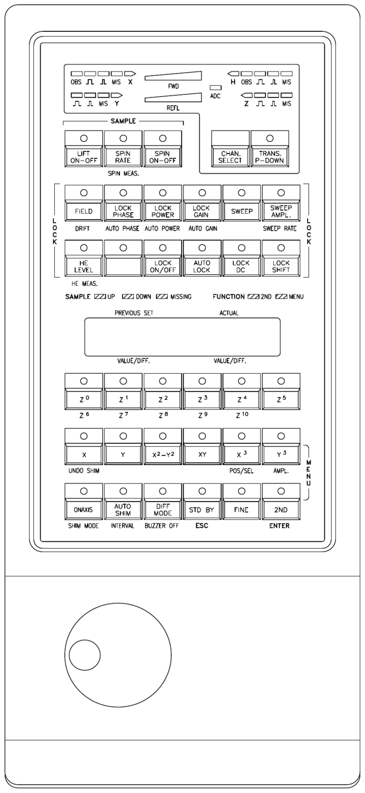
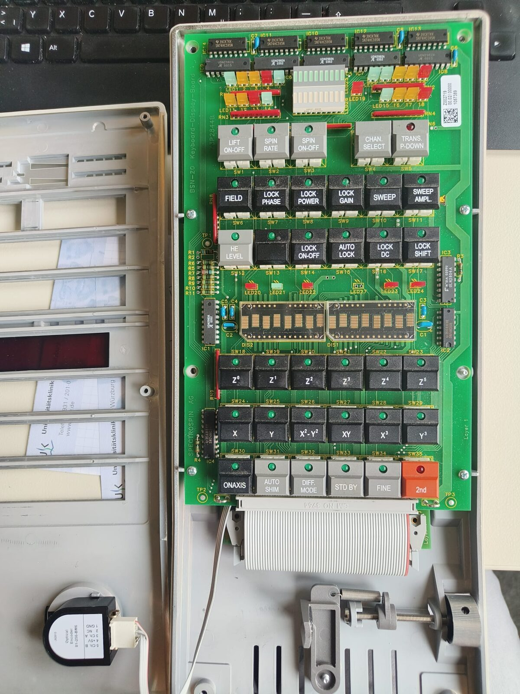
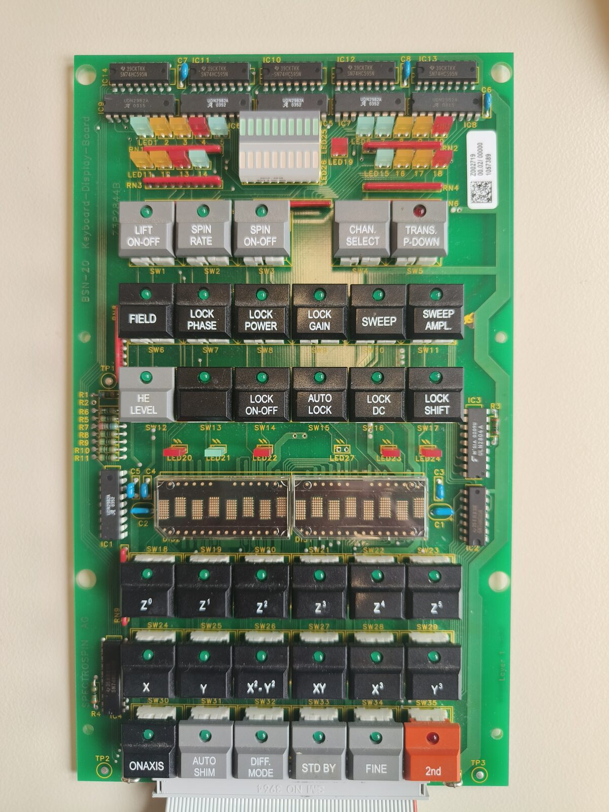
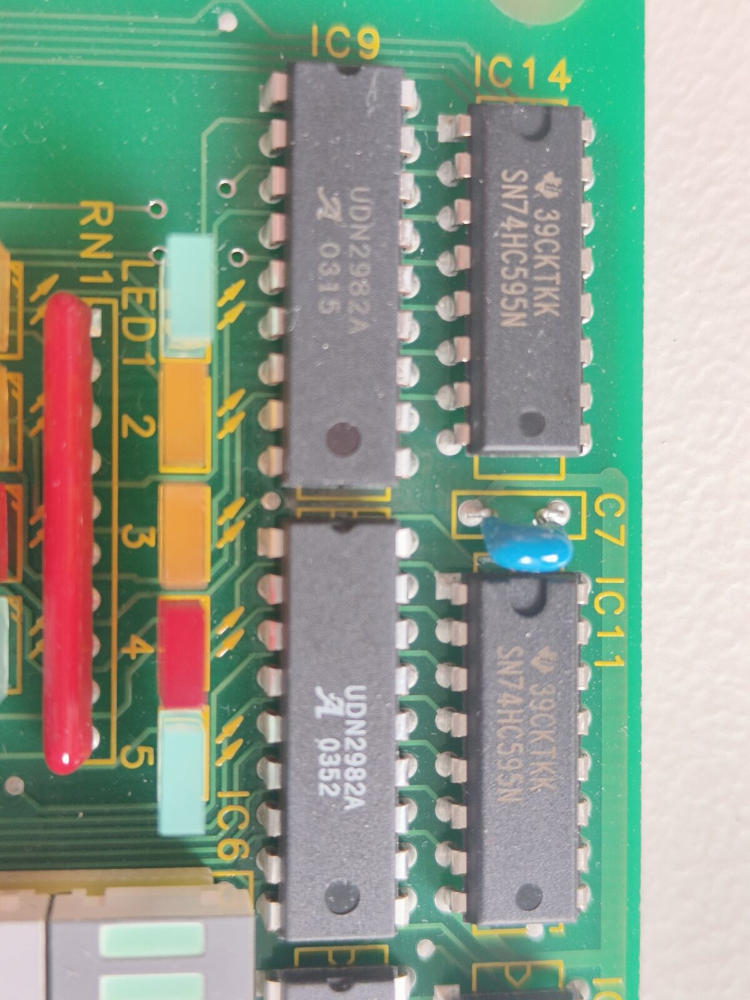
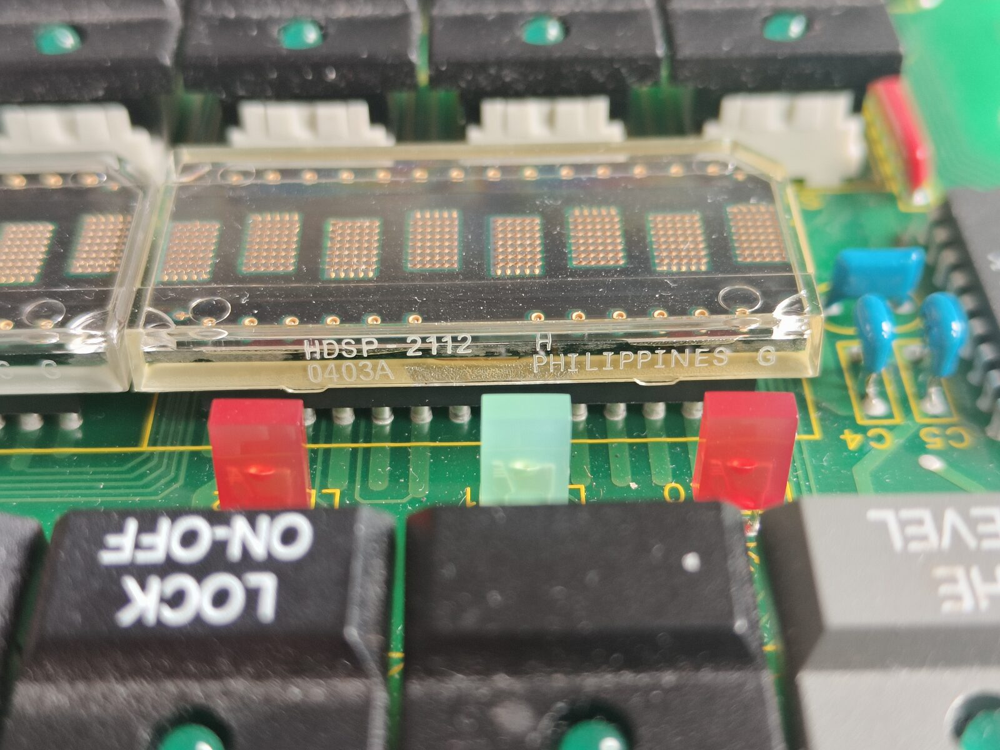
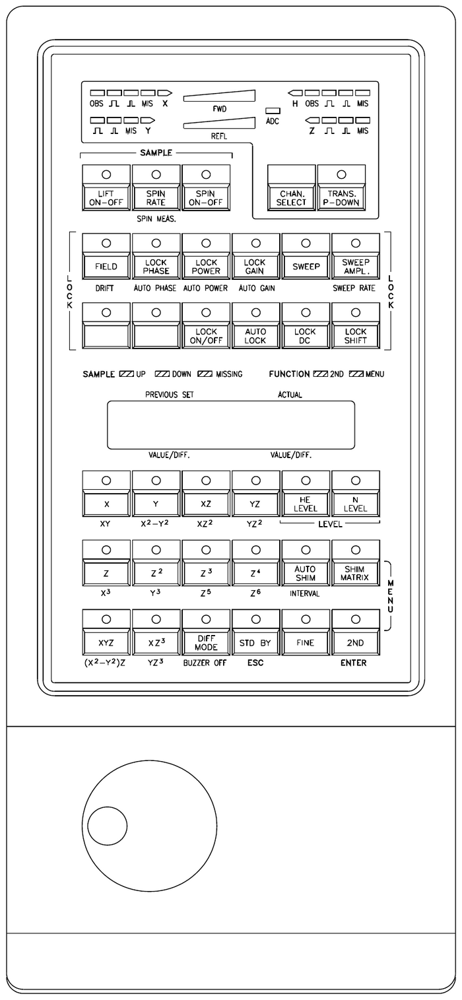
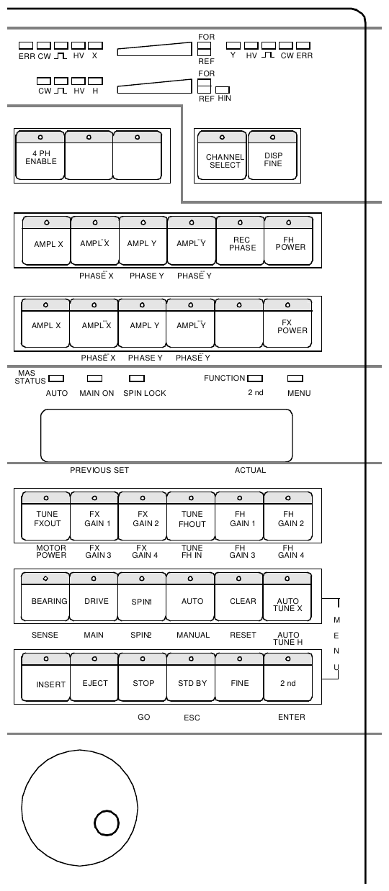
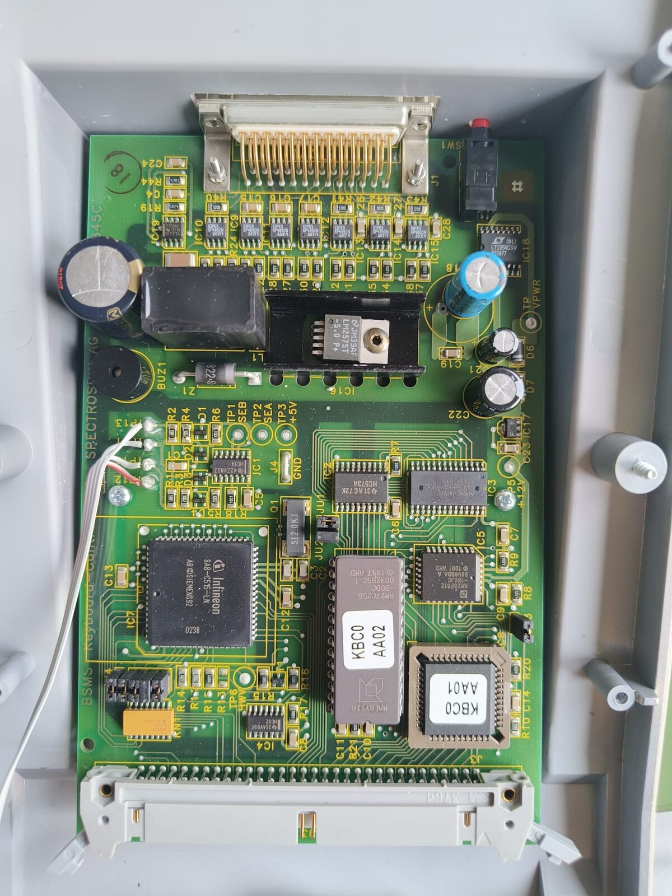

# BSMS Keyboard Boss

Eine ausgemusterte **Bruker-BSMS/2-Tastatur** wird per Reverse-Engineering zum **USB-HID-/MIDI-Controller** umgebaut. Die Tastatur ist die Bedieneinheit der BSMS-Steuerung eines Bruker-NMR-Spektrometers, Version „BOSS“. Zum Testen hängt ein Arduino Mega 2560 am 64-poligen Flachbandkabel des Keyboard-Display-Boards. Die originale Controller-Platine fliegt raus.

  
  &nbsp;&nbsp;
  

Links: Originallayout aus dem Bruker BSMS User Manual (z31185, Figure 2). Rechts: das geöffnete Gerät.

## Stand

Die **gesamte Bedienhardware läuft** am Arduino Mega mit der Demo-Firmware `arduino/keys`:

| Teil | Status |
|---|---|
| 35 Tasten (6×6-Matrix + 2 Direkttasten) | ✅ |
| Tasten-LEDs und Status-LEDs LED20–24 (gemultiplexte LED-Matrix) | ✅ |
| Router-Display LED1–19 und Bargraphs FWD/REFL (Kette aus 5 × 74HC595) | ✅ alle 40 Positionen einzeln |
| 2 × HDSP-2112 (16 Zeichen): Text, Umlaute, Pixel-Emojis, Animation, Helligkeit, Uhr | ✅ |
| Optischer Drehregler S1-256-BM6 (1024 Schritte/Umdrehung) | ✅ |
| USB-HID / MIDI | ⏳ geplant |
| Eigene Platine | ⏳ geplant |

Dazu gibt es eine grafische Oberfläche (`tools/keyboard_gui.py`). Sie spiegelt Tasten, LEDs, Displays und den Drehregler in Echtzeit. Ein Mausklick wirkt wie ein Tastendruck, ein Klick auf eine Router-LED schaltet sie um, und über ein Eingabefeld lässt sich Text auf die Displays schicken.

  
  
  

Keyboard-Display-Board „BSN-20“ (Spectrospin Z5P2844B) · Router-LEDs mit 74HC595/UDN2982A · die beiden HDSP-2112

### Tastenfunktionen der Demo-Firmware

| Taste | Funktion |
|---|---|
| ONAXIS / 2nd | Pegel der Bars +1 / −1 (gehalten mit Wiederholung) |
| STD BY | Pegel 0, alle Router-LEDs aus |
| TRANS. P-DOWN | Lauflicht über LED1–19, die Bars laufen mit |
| CHAN. SELECT | Kanal H → X → Y → Z → aus (Pfeil-LEDs) |
| HE LEVEL, (leer), LOCK ON-OFF, LOCK DC, LOCK SHIFT | LED20–24 blinkend an/aus |
| SWEEP | Display-Animation: Strichmännchen + Laufschrift. Mit dem Drehrad läuft das Männchen vor und zurück |
| SWEEP AMPL. | Spalt zwischen den Zeichen für das Männchen (0–5 Pixel) |
| DIFF. MODE | Uhr `09:15:42  13.10.` (Zeit kommt vom PC) |
| FINE | Display-Helligkeit 13 → … → 100 % |
| Drehrad | Pegel der Bars einstellen (0–20) |
| alle anderen | eigene LED an/aus, das Display zeigt den Tastennamen |

## Varianten

Dieselbe Tastatur gab es in mindestens drei Varianten. Sie haben dasselbe Gehäuse und dasselbe Tastenraster, nur Frontfolie, Tastenkappen und Firmware unterscheiden sich. Vermutlich gilt das Reverse-Engineering hier für alle drei.

| Teilenummer | Typ | Einsatz |
|---|---|---|
| Z002706 | BSMS-HR20 | BSMS-Steuerung mit HR-20-Shimsystem (20 Shims, N-LEVEL, SHIM MATRIX) |
| **Z012706** | **BSMS KEYBOARD BOSS** | BSMS-Steuerung mit BOSS1/2-Shims, **dieses Gerät** |
| Z032706 | B-HPCU | High Power Control Unit für Festkörper-NMR (Verstärker, 4-Phasen-Modulator, MAS) |

  
  
  

BOSS (z31185 Fig. 2) · HR-20 (z31185 Fig. 3) · B-HPCU (z31314 Fig. 10.1)

Das HPCU-Handbuch bestätigt unsere Messungen:
- Das Router-Display bekommt einen **40-Bit-Bitstrom** (DLED/DCLK/DSTRB), genau unsere 595-Kette mit 40 Positionen.
- **Zwei Tasten sind direkt verdrahtet** (TOGGLE und FINE bzw. TPD), das sind unsere Direkttasten oben rechts.
- Zum Gerät läuft ein 25-poliges Kabel mit RS-485 (9600 Baud), versorgt mit ca. 10 V.

Schaltpläne der Tastatur oder andere Umbauprojekte haben wir im Netz nicht gefunden. Die Bruker-Handbücher stammen aus dem [Bruker Advanced Service Handbook](https://2210pc.chem.uic.edu/nmr/downloads/BASHCD10/contents.html), gespiegelt an der UIC.

## Hardware

- **Keyboard-Display-Board** (bleibt): 35 Taster mit LEDs, Router-Display (LED1–19, zwei 10er-Bargraphs HDSP-4830), zwei HDSP-2112.
  - Treiber: 74HC595 (IC10–14), UDN2982A (High-Side), ULN2804A (Low-Side), 74HC05 (Tastenzeilen), 74HC245 (LED-Spaltenbus).
- **Controller-Platine** (fliegt raus): 80C535, RS-485 zum BSMS-Rack.
- **Encoder:** optisch, S1-256-BM6, 256 Striche, Quadratur.
- **Schaltpläne gibt es keine.** Alles unten ist gemessen: Durchgangsprüfung, interaktive Brute-Force-Tools mit dem Mega und eine „Messspitze“ an D13 (`pin_tracer`).

  

Die originale Controller-Platine (80C535): wird nicht mehr gebraucht

## Pinbelegung

Die 64 Adern des Flachbandkabels heißen hier **P01–P64**. In Klammern steht der Pin am Arduino Mega in der aktuellen Testverdrahtung. Die vollständige Messtabelle mit allen Messwegen steht in [`PINOUT.md`](PINOUT.md).

### Versorgung

| Adern | Funktion | Anschluss |
|---|---|---|
| P01, P03, P05, P07, P09 (JU1) | GND Logik | GND (nur P01 anklemmen) |
| P61–P64 (JU2) | GND der LED-Senken (ULN2804A) | GND (nur P61) |
| P11, P13, P15 (TP3) | +5 V für 74HC05, 74HC245, 74HC595, Displays | 5V (nur P11) |
| P17, P19, P21, P23 (TP2) | **LED-Versorgung VS**, original ca. 12 V; 5 V reichen **nicht** | VIN bei 9-V-Netzteil (nur P17) |
| P52 (TP1) | ca. 0,7 kΩ nach GND | – |

### Tastenmatrix

Zeilen **aktiv HIGH** (74HC05-Eingänge mit Pull-down), Spalten **aktiv LOW** (Pull-ups auf dem Board).

| Zeile ↓ / Spalte → | P45 (A6) | P44 (A13) | P43 (A5) | P42 (A12) | P41 (A4) | P40 (A11) |
|---|---|---|---|---|---|---|
| **P16** (D35) | SW1 LIFT ON-OFF | SW2 SPIN RATE | SW3 SPIN ON-OFF | – | – | – |
| **P14** (D33) | SW6 FIELD | SW7 LOCK PHASE | SW8 LOCK POWER | SW9 LOCK GAIN | SW10 SWEEP | SW11 SWEEP AMPL. |
| **P12** (D31) | SW12 HE LEVEL | SW13 (leer) | SW14 LOCK ON-OFF | SW15 AUTO LOCK | SW16 LOCK DC | SW17 LOCK SHIFT |
| **P10** (D29) | SW18 Z0 | SW19 Z1 | SW20 Z2 | SW21 Z3 | SW22 Z4 | SW23 Z5 |
| **P08** (D27) | SW24 X | SW25 Y | SW26 X²-Y² | SW27 XY | SW28 X³ | SW29 Y³ |
| **P06** (D25) | SW30 ONAXIS | SW31 AUTO SHIM | SW32 DIFF. MODE | SW33 STD BY | SW34 FINE | SW35 2nd |

Direkttasten, aktiv LOW: **P59 (D7) = SW4 CHAN. SELECT**, **P58 (D12) = SW5 TRANS. P-DOWN**.

### LED-Matrix

- **Die Tastenzeilen sind gleichzeitig die LED-Zeilen.** Dazu kommt P04 (D23) als 7. Zeile für die Status-LEDs. Zeile HIGH = aktiv, Low-Side über den ULN2804A.
- **Spalten = Bus P46–P51** (A14, A7, A15, D2, D8, D3), HIGH = an. Er läuft über den 74HC245 auf den UDN2982A, freigegeben mit **P28 (D47) = LOW**.
- Gemultiplext wird immer eine Zeile zur Zeit. Spalte 1–6 entspricht derselben Reihenfolge wie die Tastenspalten.
- Zeile P04: Spalte 1 LED20 (rot), 2 LED21 (grün), 3 LED22 (rot), 4 LED27 (nicht bestückt), 5 LED23 (rot), 6 LED24 (rot).
- CHAN. SELECT hat keine LED. Die LED von TRANS. P-DOWN sitzt in der 595-Kette.

### Router-Display: 74HC595-Kette (IC10 → IC14)

| 595-Pin | Funktion | Ader |
|---|---|---|
| 11 SRCLK | Schiebetakt | P56 (D11) |
| 12 RCLK | Übernahme | P57 (D6) |
| 13 /OE | Ausgänge frei bei LOW | P28 (D47), **gemeinsam mit /OE des 74HC245** |
| 10 /SRCLR | Löschen | P55 (D5) |
| 14 SER (IC10) | Dateneingang DLED | **P60 (D14)** |

P60 haben wir lange für die 5-V-Versorgung der 595 gehalten (ein Piepser-Messfehler). Solange P60 an 5 V hing, ließ sich die Kette nur mit Einsen füllen. Seit dem 23.10.2026 hängt P60 an einem Datenpin, und alle 40 Positionen sind einzeln schaltbar. Das zuerst geschobene Bit landet auf Position 40:

| Position | LED |
|---|---|
| 1–10 | Bargraph LED25 FWD (grün) |
| 11–20 | Bargraph LED26 REFL (rot) |
| 21–40 | LED5, 6, 14, 15, 1, 7, 4, 10, 13, 18, *TRANS. P-DOWN*, 19, 2, 8, 11, 16, 3, 9, 12, 17 |

Lage auf der Frontblende (⊓ = Puls-Symbol):

| | links | Mitte | rechts |
|---|---|---|---|
| oben | LED1 OBS · 2 ⊓ · 3 ⊓ · 4 MIS · 5 X→ | Bargraph FWD | 6 ←H · 7 OBS · 8 ⊓ · 9 ⊓ · 10 MIS |
| Mitte | | | LED19 ADC (rot) |
| unten | LED11 ⊓ · 12 ⊓ · 13 MIS · 14 Y→ | Bargraph REFL | 15 ←Z · 16 ⊓ · 17 ⊓ · 18 MIS |

Abhilfe wäre ein kleiner Umbau: die Leiterbahn an IC10 Pin 14 auftrennen und auf einen freien Controller-Pin legen. Dann wären alle Router-LEDs frei schaltbar.

### Displays HDSP-2112

**DIS2 sitzt links, DIS1 rechts.** Die Zeichenposition 0 ist jeweils links. Alle Signale gehen direkt ans Kabel; D0–D7, Adressen, /WR, /RD, /FL und /RST teilen sich beide Displays.

| HDSP-Pin | Signal | Ader | Mega |
|---|---|---|---|
| 19, 20, 23–28 | D0–D7 | P38, P37, P36, P35, P34, P33, P32, P30 | A10, A2, A9, A1, A8, A0, D51, D49 |
| 3–6, 10 | A0–A4 | P24, P25, P27, P29, P31 | D43, D46, D48, D50, D52 |
| 13 | /WR | P54 | D10 |
| 18 | /RD | P53 | D4 |
| 17 | /CE DIS1 / DIS2 | P18 / P20 | D37 / D39 |
| 2 | /FL | P22 | D41 |
| 1 | /RST | P39 | A3 |
| 11 /CLS, 12 CLK | DIS2 = Takt-Master, DIS1 = Slave | – | – |

Pro Display gibt es 16 selbstdefinierbare 5×7-Zeichen (UDC): 4 nutzt das animierte Strichmännchen, 12 sind Ä Ö Ü ä ö ü ß und ☺ ☹ ♥ ♪ ★.

Noch ohne bekannte Funktion: **P26** (D45) und **P02** (nicht angeschlossen).

### Encoder

| Encoder-Pin | Funktion | Mega (Test) |
|---|---|---|
| 1 | GND | GND |
| 2 | NC | – |
| 3 | Ch A | D19 (Interrupt) |
| 4 | +5 V | D20 als HIGH-Ausgang (Notlösung, 4,6 V) |
| 5 | Ch B | D21 (Interrupt) |

## Wie geht es weiter?

Ziel ist ein kompaktes Gerät, das ins vorhandene Gehäuse passt. Es soll sich am PC als **USB-HID und/oder USB-MIDI** melden und per USB geflasht werden.

**Favorit: Raspberry Pi Pico 2 W auf einer eigenen Platine**

- Ein Anschluss mit **46 Leitungen** würde die 26 GPIO des Pico sprengen. Mit zwei Kniffen reichen **22 GPIO**:
  - /RD und /FL der Displays fest auf HIGH, /RST per RC-Glied.
  - **3 × 74HCT595** auf der Platine dienen gleichzeitig als Pegelwandler (3,3 V → 5 V) und als Port-Erweiterung. Sie übernehmen Zeilen, LED-Bus, Kettensignale sowie Display-Adressen und /CE.
- Direkt am Pico bleiben Display-Daten + /WR (TTL-Eingänge, 3,3 V reichen), Tasten-Spalten, Direkttasten und der Encoder.
- **Es muss der RP2350 sein** (Pico 2), weil seine Eingänge 5-V-tolerant sind, nicht der RP2040.
- Der Pico 2 W bringt USB-HID, USB-MIDI und Seriell gleichzeitig mit, dazu Bluetooth-MIDI/-HID und WLAN, z. B. für die Uhrzeit per NTP.

**Alternativen**

- Arduino Mega + **HoodLoader2** auf dem USB-Chip ATmega16U2: HID + MIDI ohne neue Hardware.
- Mega + ESP32-S3 als USB/Bluetooth/WLAN-Brücke.
- RP2350B-Modul (48 GPIO) mit Pegelwandlern.
- Zum schnellen Ausprobieren: ein PC-Programm, das die serielle Ausgabe in MIDI umsetzt.

**Smarthome:** Die Tastatur eignet sich auch als **Home-Assistant-/MQTT-Bedienteil**:
- Tasten schalten Lichter und Szenen, ihre LEDs zeigen den echten Zustand.
- Das Drehrad dimmt oder regelt.
- Das Display zeigt Uhrzeit, Temperaturen und Nachrichten, die Bargraphs Pegel wie PV-Leistung und Verbrauch.
- Per MQTT-Discovery erscheinen alle Elemente automatisch in Home Assistant.
- Prototyp: eine Python-Brücke Seriell ↔ MQTT. Endausbau: Pico 2 W direkt per WLAN.

**MIDI:** USB-MIDI ist am einfachsten und braucht keinen Treiber. Ein klassischer 5-poliger DIN-Ausgang ist mit UART + 2 Widerständen nebenbei möglich.

**Platine (KiCad)** mit:
- Controller-Modul und 3 × 74HCT595
- 2×32-Wannenstecker für das Flachbandkabel
- 4-poliger Encoder-Leiste
- Versorgung: 9–12-V-Netzteil → Step-Down auf 5 V für Logik und Displays, LED-Versorgung VS direkt aus 9–12 V

Davor stehen noch drei Messungen an:
- Stromaufnahme
- Rastermaß des Kabelsteckers
- fliegender Test mit einem Pico 2

## Verzeichnis

- [`PINOUT.md`](PINOUT.md): vollständige Messtabelle aller 64 Adern mit Messwegen
- [`CLAUDE.md`](CLAUDE.md): Projekt-Logbuch mit allen Messungen, Irrwegen, Erkenntnissen und der ausführlichen Planung
- `arduino/`: Sketches
  - `keys` = Demo-Firmware für das ganze Board
  - Mess- und Test-Sketches: `pin_tracer`, `led_probe`, `led_test`, `display_test`, `matrix_probe`, `line_state`, `conn_scan`
- `tools/`: Python-Werkzeuge (Windows-Python mit pyserial)
  - `keyboard_gui.py` = grafische Oberfläche
  - interaktive Messprogramme wie `pin_tracer.py`, `led_finder.py`, `led_test.py`, `matrix_finder.py`
- `logs/`: Mitschnitte der Messläufe
- `Fotos_web/`: Fotos der geöffneten Tastatur (verkleinert)
- `Manuals/`: Original-Handbücher von Bruker/Spectrospin (BSMS User Manual, BSMS und BSMS/2 Mainframe Technical Manual, BSMS Shim Manual, B-HPCU User Manual)
- `docs/img/`: Bilder für diese README
